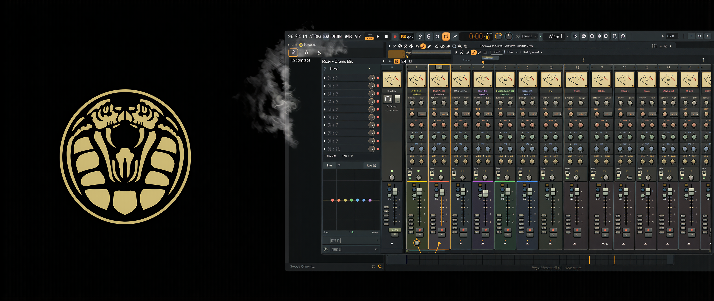
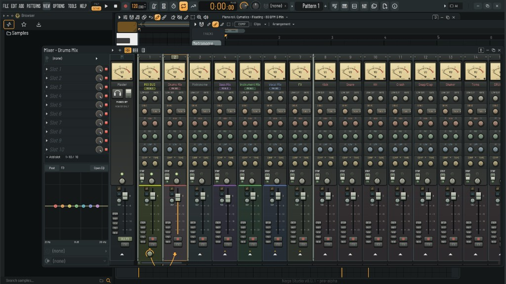

# Naga Studio

Mac community preview for Apple silicon. The mixer is the analog console, with channel strips on the inserts and Naga Wave in the instrument list.

## Install

Download [Naga-Studio-Installer-naga-logo.dmg](Naga-Studio-Installer-naga-logo.dmg), open it, and run `Naga-Studio-0.0.1-macOS-arm64-UNSIGNED.pkg`.

This package is unsigned and not notarized. macOS may block it. Approve it in System Settings, Privacy & Security.

## Plugins

Install and license your own compatible VST3, VST2, or CLAP plugins. Audio Units, AAX, and FL Studio-exclusive plugins are not loaded directly. An Apple silicon process cannot load Intel-only plugins.

The vertical post is [docs/social.png](docs/social.png).

Powered by [Naga Codex](https://nagacodex.cloud)
